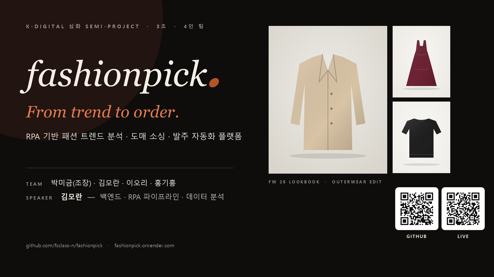

# fashionpick

**RPA 기반 패션 트렌드 키워드 분석, 도매 상품 소싱 및 발주 자동화 플랫폼**

패션 쇼핑몰 운영을 자동화하는 커머스 플랫폼입니다. RPA(Playwright · BeautifulSoup)가 다음 세 가지 일을 합니다.

1. **트렌드 수집**: 네이버 데이터랩 쇼핑인사이트, 패션 플랫폼 랭킹, SNS 해시태그 등에서 트렌드 키워드를 모읍니다.
2. **상품 소싱**: 수집한 키워드로 도매 사이트(동대문·신상마켓·도매꾹 등)를 검색해 상품 이미지와 정보(가격, 옵션, 재고)를 가져옵니다.
3. **발주 자동화**: 주문이 들어오면 공급처별 발주서(Excel/PDF)를 작성해 발송하고, 실시간 알림을 보냅니다.

- **팀 (4인)**: 박미금(조장), 김모란, 이오리, 홍기흥

| 구분 | URL |
|---|---|
| GitHub Repository | https://github.com/fsclass-n/fashionpick |
| GitHub Pages | https://fsclass-n.github.io/fashionpick/ |
| Frontend Staging (Netlify) | https://fashionpick.netlify.app |
| Frontend Production (Render) | https://fashionpick.onrender.com |
| Backend API (Render) | https://fashionpick-api.onrender.com (`/docs`) |

## 발표·시연 영상 (10분)

[](https://github.com/fsclass-n/fashionpick/releases/download/video-v1/fashionpick_final.mp4)

- 본편 다운로드: [fashionpick_final.mp4](https://github.com/fsclass-n/fashionpick/releases/download/video-v1/fashionpick_final.mp4) (10:00 · 1080p · 58MB) · 자막 [SRT](https://github.com/fsclass-n/fashionpick/releases/download/video-v1/fashionpick_final.srt)
- 저장소 파일: [docs/video/3조_final.mp4](docs/video/3조_final.mp4)
- 60초 하이라이트: [docs/video/3조_highlight.mp4](docs/video/3조_highlight.mp4)
- 발표자 김모란 · 내레이션은 여성 신경망 합성 음성(`ko-KR-SunHiNeural`)입니다. 대본·동선: [영상_대본_및_연출가이드.md](docs/video/영상_대본_및_연출가이드.md)

| 시간 | 내용 |
|---|---|
| 00:00 | PPT 발표 — 문제 정의 · 아키텍처 · RPA 파이프라인 · 분석 로직 · 권한 · 배포 · 트러블슈팅 |
| 03:38 | 일반 회원 시연 — 메인 · 트렌드 · 테스트 로그인 · 상품 상세 · 주문 → 발주서 자동 생성 · 마이페이지 |
| 06:10 | 일반 회원의 관리자 주소 접근 차단 |
| 06:25 | 테스트 관리자 시연 — 읽기 전용 배너 · 소싱 · 발주서 미리보기 · RPA 모니터 · 회원 권한(변경 잠금) |
| 08:20 | 권한 비교 — 일반 회원 · 테스트 관리자 · 실제 관리자 |
| 08:42 | 운영 API 문서 (`/docs`) |
| 09:00 | 클로징 — 회고 · 향후 계획 · Q&A |

## 기술 스택

| 영역 | 기술 |
|---|---|
| Frontend | React 19 (Vite), Tailwind CSS v4, React Router, FontAwesome, Plotly.js, Playfair Display + Pretendard |
| Backend & API | Python 3.11, FastAPI, WebSockets, SQLAlchemy 2, PyJWT, python-dotenv |
| Database | TiDB Cloud (`fashionpick`). 로컬에서는 SQLite로 대체 |
| RPA & Data | Playwright (Chromium), BeautifulSoup4, Requests, NumPy, pandas, Plotly |
| Document | openpyxl (Excel 발주서), ReportLab (PDF 발주서) |
| Cloud & CI/CD | Render (Docker + Static), Netlify, Docker Compose, GitHub Actions, GitHub Pages |
| External | 네이버 데이터랩 API, Google·Naver·Kakao OAuth, SMTP, Telegram·Discord 웹훅 |

## 디렉터리 구조

```
fashionpick/
├── backend/
│   ├── app/
│   │   ├── main.py          # FastAPI 앱, lifespan(테이블 생성·시드·스케줄러)
│   │   ├── config.py        # .env 기반 설정
│   │   ├── database.py      # TiDB(TLS)/SQLite 엔진
│   │   ├── models.py · schemas.py · security.py
│   │   ├── routers/         # auth · trends · catalog · orders · admin · realtime(ws)
│   │   └── services/        # trends · catalog · ordering · rpa_jobs · realtime · seed
│   ├── tests/               # pytest
├── frontend/                # React + Vite + Tailwind v4
│   └── src/{pages,components,context,lib}
├── rpa/
│   ├── trend/               # 트렌드 키워드 수집·분석
│   ├── sourcing/            # 도매 상품·이미지 수집
│   └── purchase_order/      # 발주서 Excel/PDF 생성, 메일·웹훅 발송
├── docs/                    # GitHub Pages, 설계서, 배포 가이드
├── .github/workflows/       # ci · deploy · pages
├── .env.example             # 환경 변수 (Render 필수 항목 표시)
├── requirements.txt
├── Dockerfile             # 백엔드 이미지 (Playwright Chromium 포함, Render)
├── docker-compose.yml · render.yaml · netlify.toml
```

## 빠른 시작

```bash
py -3.11 -m venv .venv && .venv\Scripts\activate
pip install -r requirements.txt
playwright install chromium
copy .env.example .env

uvicorn backend.app.main:app --reload --port 8000
cd frontend && npm ci && npm run dev
```

1. http://localhost:5173 에 접속하면 메인 페이지가 열립니다.
2. **[일반 회원 테스트 로그인]**으로 로그인한 뒤 상품 상세에서 **바로 구매하기**를 누르면 주문이 접수되고 공급처별 발주서가 자동으로 생성됩니다.
3. 관리자 화면은 두 가지 방법으로 들어갈 수 있습니다.
   - **[테스트 관리자 로그인]**: 읽기 전용으로 둘러봅니다.
   - `/admin/login` + `.env`의 `ADMIN_TOKEN`: 실제 관리자로 들어가 테스트 주문 발생, 발주서 발송, RPA 실행 등 모든 작업을 할 수 있습니다.

`RPA_MODE=demo`(기본값)는 외부 사이트에 접속하지 않고 샘플 데이터로 전체 흐름을 보여 줍니다. 실제 수집을 하려면 다음을 설정하세요.

- `RPA_MODE=live`
- `NAVER_DATALAB_CLIENT_ID` / `NAVER_DATALAB_CLIENT_SECRET`
- `TREND_SCRAPE_TARGETS`
- `WHOLESALE_TARGETS`

자세한 내용은 [docs/deployment.md](docs/deployment.md)와 [docs/architecture.md](docs/architecture.md)에 있습니다.

## 권한 체계

| 권한 | 진입 방법 | 할 수 있는 일 |
|---|---|---|
| 일반 회원 | 회원가입 · 소셜 로그인 · [일반 회원 테스트 로그인] | 쇼핑, 주문, 마이페이지 |
| 실제 관리자 | `/admin/login`에서 `.env`의 `ADMIN_TOKEN`으로 인증 | 관리자 화면 + 전체 CRUD |
| 테스트 관리자 | [테스트 관리자 로그인] | 관리자 화면 조회만 가능 (생성·수정·삭제는 서버에서 차단) |

## 주요 기능

- **공통 레이아웃**
  - 모든 페이지(메인, 상품 목록·상세, 마이페이지, 관리자 등)에 같은 글로벌 헤더와 푸터를 씁니다.
  - 헤더: 유틸리티 바, GNB, 검색, 카테고리 바
  - 푸터: 회사 정보, 고객센터, 이용약관·개인정보처리방침, SNS, 원형 To the Top 버튼
  - 처음 접속하면 메인 페이지(`/`)로 들어갑니다.
- **스토어프런트**
  - 메인: 룩북 히어로 캐러셀, 실시간 트렌드 키워드, 카테고리, NEW ARRIVALS, LOOKBOOK, TREND PICKS
  - 상품 목록: 카테고리·정렬·검색
  - 상품 상세: 색상별 이미지, 옵션 선택, 바로 구매
  - 마이페이지: 주문 진행 단계, 회원 정보, 알림 설정

- **로그인 (Split Layout)**
  - 좌측: 시즌 룩북 무드 그래픽과 실시간 트렌드 TOP 10. 모바일에서는 마퀴로 압축됩니다.
  - 우측: 로그인 폼
  - 테스트 계정 간편 로그인 (자동 입력 후 세션 처리)
  - Google·네이버·카카오 OAuth
  - 비밀번호 규칙 실시간 검사
- **GNB**
  - 햄버거 ↔ X 아이콘 모션
  - 우측에서 좌측으로 열리는 슬라이딩 드로어 (키워드 검색, 카테고리, 알림 설정)
- **디자인**
  - 모노톤 에디토리얼 컬러에 시즌 포인트 컬러
  - 라이트/다크 모드
  - 세리프 타이틀 서체와 본문 서체 분리
  - FontAwesome 아이콘, To the Top 버튼
- **트렌드**: 워드클라우드, 검색 지수 라인 차트, 카테고리 트리맵, Top 12 바 차트, 순위 변동·급상승 하이라이트
- **소싱**
  - Masonry 갤러리 (모바일 2열, 태블릿 3열, 데스크톱 4~5열)
  - 상품 카드에 도매가·예상 판매가·마진율·옵션·공급처 표시
  - 트렌드 추천 상품명으로 원클릭 등록
- **주문·발주**
  - WebSocket 주문 팝업과 토스트 알림
  - 공급처별 발주서 자동 생성, 미리보기, Excel/PDF 다운로드
  - 이메일·웹훅 발송, 상태 추적 (대기 → 발송 완료 → 입고 확인)
- **관리자**
  - RPA 작업 주기 설정, 즉시 실행, 로그, 성공률 차트
  - 공급처(수신 방식·템플릿) 관리
  - 일반 사용자 ⇄ 관리자 실시간 권한 변경

## 크롤링 준수사항

- 대상 사이트의 robots.txt를 확인한 뒤 수집하고, 도메인별 요청 간격 제한(Rate Limit)을 적용합니다.
- `TREND_SCRAPE_TARGETS`와 `WHOLESALE_TARGETS`에는 이용약관에서 수집을 허용하는 사이트만 등록합니다.
- 수집한 도매 이미지는 공급처가 사용을 허락한 범위 안에서만 씁니다.
